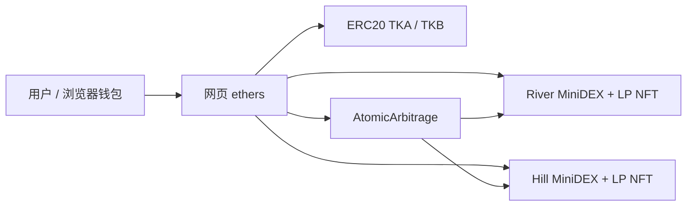
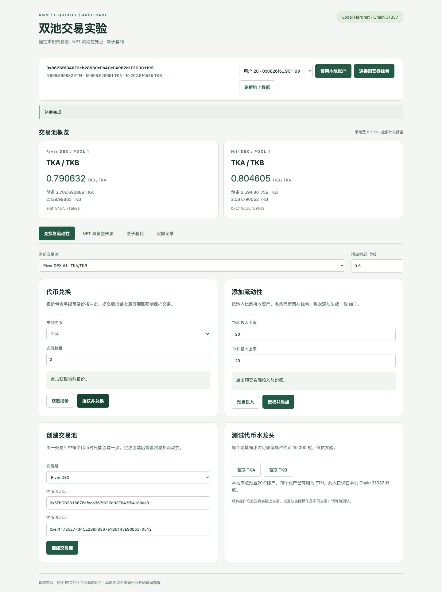
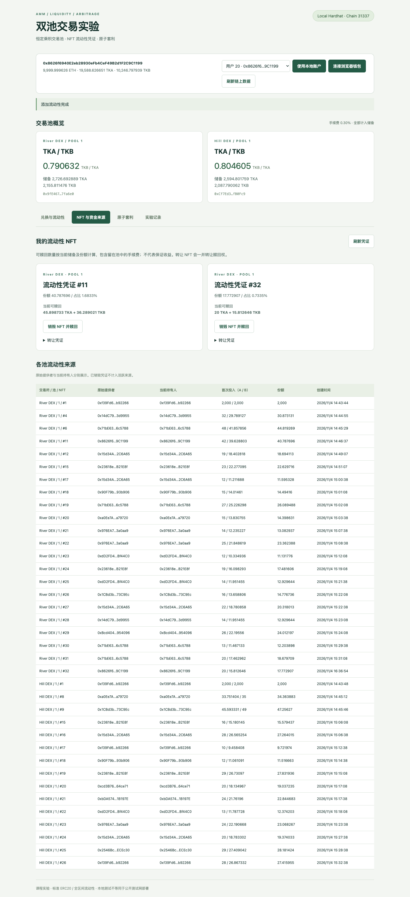
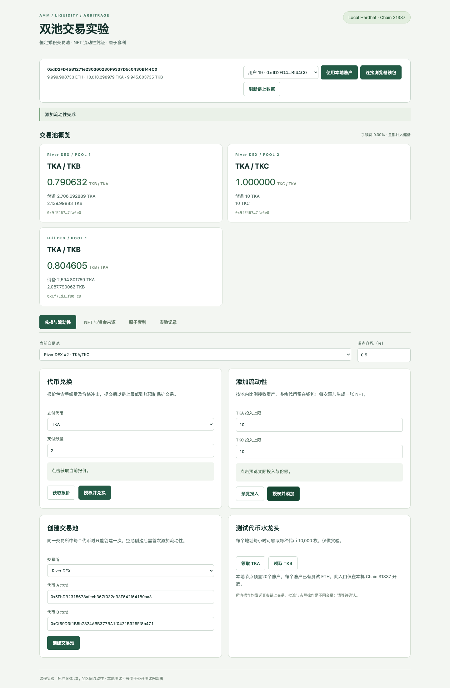
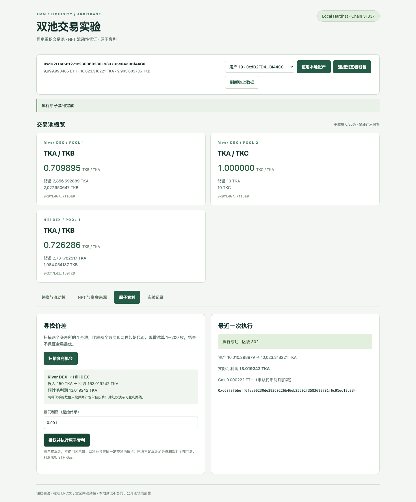
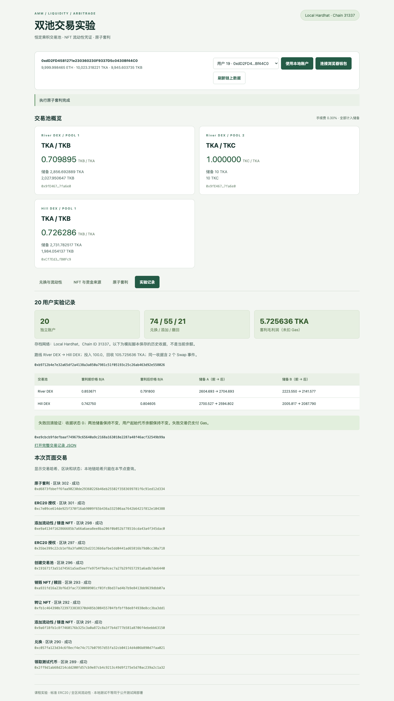

# 双池 AMM DEX 与原子套利

基于恒定乘积做市机制的课程 DApp，包含 ERC20 测试代币、两个独立交易所、ERC721 流动性凭证和自有本金原子套利。网页直接读取和调用合约，所有截图均来自本地链实际运行。

**姓名：待填写　学号：待填写**

本项目参考课程 [ZJU-blockchain-course-2026](https://github.com/LBruyne/ZJU-blockchain-course-2026) 的 Hardhat 3 工程结构，参考版本为 `6f90ad4f6b89d00ff00943743addc903418a62c5`。保留其合约工具链，并实现原框架中尚未完成的业务合约；前端使用 Vite、原生 JavaScript 和 ethers 6。代码与文档由 AI 辅助实现，测试和截图均为实际执行结果。

## 完成情况

| 作业要求 | 实现及验证 |
|---|---|
| 至少两种 ERC20、多用户领取 | TKA、TKB，18 位精度；每地址每小时可领取每种代币 10,000 枚 |
| 网页创建 AMM 池 | 支持标准 ERC20 地址；同一交易所中同一代币对不可重复创建，反向输入也会被识别 |
| 恒定乘积、储备、手续费 | 双向兑换，0.30% 手续费留存池中，网页展示储备与价格 |
| 添加和撤回流动性 | 按池内比例添加，铸造 ERC721；持有人销毁 NFT，领取当前储备的相应份额 |
| NFT 信息、流动性来源 | 展示交易所、池号、份额、首次投入、创建时间、原始提供者和当前持有人；支持转让 |
| 多用户持续模拟 | 20 个地址；先逐一操作，再执行 100 步带固定种子的随机操作，共 150 次业务操作 |
| 多交易所价差（加分） | River DEX、Hill DEX 各有 TKA/TKB 池，用户在两个池子交易 |
| 原子套利（加分） | 一笔交易内完成两次兑换；第二腿回收不足本金与最低利润时全部回滚 |
| 文档与截图 | 本 README、合约说明、真实交易 JSON、6 张网页截图、实验报告 |
| 视频 | 按本次要求不录制 |

图片要求至少 10 个用户，课程仓库 README 写至少 20 个，因此采用 20 个。题目要求网站交互与测试代币，没有指定必须使用公开测试网。本次运行网络为 **本地 Hardhat，Chain ID 31337**；可选的 Sepolia 部署脚本已提供但尚未执行。公开仓库：[spursergmk/amm-dex-coursework](https://github.com/spursergmk/amm-dex-coursework)。姓名学号仍待填写，未发送提交邮件。

## 1. 安装与运行

建议 Node.js 24，实测 Node.js 24.18.0、npm 11.16.0。项目保留两个 `package-lock.json`，按锁文件安装。

```bash
git clone https://github.com/spursergmk/amm-dex-coursework.git amm-dex
cd amm-dex
npm run setup
```

在终端一启动本地链，并保持运行：

```bash
npm run node
```

节点默认地址 `http://127.0.0.1:8545`，预置 20 个有测试 ETH 的账户。开发账户是 Hardhat 的公开测试账户，只用于本地实验。

在终端二依次部署、运行模拟、启动网页：

```bash
npm run deploy
npm run simulate
npm run dev
```

访问 **http://127.0.0.1:5173**。选择“用户 01—20”，点击“使用本地账户”即可操作，无须导入私钥。也可在 MetaMask 添加本地网络（RPC `http://127.0.0.1:8545`，Chain ID `31337`）并连接已有测试账户。

`deploy` 会部署两个 ERC20、两个 MiniDEX 和一个 AtomicArbitrage，并各注入 2,000 TKA / 2,000 TKB 的初始流动性。ABI 与地址自动写入 `web/public/deployment.json`，不用手工修改前端。`simulate` 会更新 `evidence/simulation.json` 及网页的历史实验记录。

**复现实验时请从新启动的空白节点开始。** 节点重启会丢失状态，需要重新部署；旧地址、余额和旧交易哈希不能证明重启后链的状态。重复部署会产生新地址并覆盖前端配置。已运行过的节点上重复模拟，其初始状态和结果会不同。

## 2. 网页操作

1. 连接账户，查看 TKA、TKB 和 ETH 余额；“领取 TKA/TKB”调用水龙头，重复领取受一小时冷却限制。模拟账户已经领过代币，可直接使用余额。
2. 在“当前交易池”选择交易所与池号，选择支付代币、填写数量、点击“获取报价”，再“授权并兑换”。滑点默认 0.5%，可设为 0—5%。
3. 填写两种代币的投入上限，点击“预览投入”。实际投入按池内比例计算，多余部分不会从钱包扣除。确认后添加流动性。
4. 打开“NFT 与资金来源”，查看份额及当前可赎回资产；可转让 NFT，或销毁 NFT 取回资产。只有当前持有人可以赎回。
5. 创建新池时填写两个**不同且已部署**的 ERC20 地址。默认两个交易所已存在 A/B 池，直接重复创建会报 `Pool exists`。创建成功后选择空池并注入首笔流动性。浏览器集成测试额外部署了 TKC，以验证网页创建 A/C 池全过程。
6. “原子套利”扫描两个交易所的 1 号池，试算两个方向、两种起始代币及 1/2/5/10/20/50/100/150/200 枚投入。填写最低利润后执行；使用自有代币本金，不需要闪电贷。
7. “实验记录”展示模拟时的历史储备、价格变化、利润及回滚收据；下方展示本次页面发出的交易哈希和区块。顶部池子卡片则显示当前链上状态，两者时间点可能不同。

本地账户入口仅在本机页面且部署链 ID 为 31337 时开放。公开测试网通过浏览器钱包签名。网页批准使用本次金额；模拟脚本为便于重复操作，对本地测试代币使用最大授权。

## 3. 合约与机制

### 3.1 架构



- `TestToken.sol`：基于 OpenZeppelin ERC20 的无经济价值测试代币，`faucet()` 向调用者铸币。
- `MiniDEX.sol`：一个交易所管理多个池，并同时作为该所的 ERC721 凭证合约。每池独立记录储备、总份额和创建时间。
- `AtomicArbitrage.sol`：校验两池代币对匹配，向调用者获取本金，顺序兑换并返还回收资产。

### 3.2 兑换价格及手续费

设输入储备为 x，输出储备为 y，输入量为 Δx，手续费率为 f = 0.003：

```text
有效输入 = Δx × (1 − f)
输出 Δy = floor[Δx × 9970 × y / (x × 10000 + Δx × 9970)]
新储备 = (x + Δx, y − Δy)
```

手续费不转给单独的管理员，而是包含在输入储备中。正常交易后 `x' × y' ≥ x × y`，单位份额对应的储备几何均值增加。网页卡片价格是储备比 `reserveB / reserveA`，实际成交报价另外考虑手续费与价格冲击，不能用卡片价格直接乘交易量估算大额成交。

整数计算使用 Solidity 检查算术和 `Math.mulDiv`；不使用浮点数决定资产转移。前端小数显示可能四舍五入，链上数量保留整数精度。

### 3.3 流动性与 NFT

首笔添加的总份额为 `floor(sqrt(A × B))`，其中 **1,000 个最小份额单位永久锁定**，其余记入 NFT。锁定份额不归任何管理员，也没有领取入口，用于避免总份额归零等边界问题。因此全部持有人赎回后会留下极小储备。

后续添加会将输入上限调整到池内比例，并按下式生成份额：

```text
新份额 = min(floor(实际 A × 总份额 / 储备 A),
             floor(实际 B × 总份额 / 储备 B))
赎回 A = floor(NFT 份额 × 当前储备 A / 总份额)
赎回 B = floor(NFT 份额 × 当前储备 B / 总份额)
```

每次添加铸造一张 NFT；`positions` 存储池号、份额、初次投入、时间和原始提供者。`tokenURI()` 返回内嵌 Base64 JSON，含池号、份额、初次投入和时间。所属交易所由 NFT 合约地址确定，代币地址可通过池号查询。

NFT 转移后原始提供者不变，`ownerOf` 返回的新持有人获得赎回权。销毁时返还的是当前储备份额，因此包含手续费，也受到价格变化和无常损失影响。首次投入与赎回金额之差不能单独解释为手续费收益。

### 3.4 原子套利

以本次实际路线为例：先在 B/A 较高的 River DEX 用 A 买 B，再在 B/A 较低的 Hill DEX 用 B 买回 A。

```text
调用者 A → 套利合约 → River DEX：A 换 B
                      → Hill DEX：B 换 A
要求回收 A ≥ 本金 A + 最低利润，否则 revert
全部回收 A → 调用者
```

`execute()` 的两次兑换、授权和转账在同一笔 EVM 交易中完成。第二腿直接以“本金 + 最低利润”作为 `minOut`。失败时包括第一腿在内的状态与日志全部回滚，但 Gas 仍然消耗。

脚本和网页都是链下扫描、链上原子执行。扫描只搜索给定离散金额，不保证最优交易量；两种起始代币的利润数值也没有使用外部汇率统一估值。利润是**起始代币毛利润**，未扣 ETH Gas，不能直接视为现实可兑现净利润。

### 3.5 边界处理

包含重入锁、SafeERC20、重复交易对检查、代币方向检查、最低到账、添加/撤回数量下限、截止时间、NFT 持有人检查和最小初始份额。收款后校验余额增量，拒绝入账数量不符的收费代币。

本实现只面向标准、非 rebasing ERC20；未支持原生 ETH/WETH 路由、集中流动性、闪电贷或协议管理员抽成。向合约地址直接转账不自动增加池储备，操作应通过公开接口。用户可以创建自定义代币池，但合约不会审核代币的经济价值或恶意行为。本项目是教学实现，未经过独立安全审计。

## 4. 实际实验结果

固定随机种子 `20261031`，20 个独立地址。先确保每个用户至少执行一次兑换和添加，然后继续 100 步随机操作。每一步推进本地链时间 30 秒，累计手动推进 3,000 秒，整个记录的链上时间跨度为 3,174 秒。**这是模拟链上约 53 分钟，不是实际等待 53 分钟，也不是并发负载测试。**

| 指标 | 实测值 |
|---|---:|
| 独立账户 | 20 |
| 普通兑换 | 74 |
| 添加流动性 | 55 |
| 撤回流动性 | 21 |
| 上述业务操作合计 | 150 |
| 模拟脚本成功交易数（含领取、授权等） | 271 |
| 额外制造价差的交易 | 350 TKA → TKB，Hill DEX |
| 套利投入 | 100 TKA |
| 套利回收 | 105.725636361839480863 TKA |
| 套利毛利润 | 5.725636361839480863 TKA |
| 同一套利收据中的 Swap 事件 | 2 |
| 故意失败的套利收据状态 | 0，且无存活日志 |

普通兑换次数不包括为清晰演示价差而显式添加的 350 TKA 交易，也不包括套利内部的两次兑换。这些额外交易全部记录，未将价差形成描述为纯随机结果。

| 池 | 套利前价格（TKB/TKA） | 套利后价格（TKB/TKA） | A 储备变化 | B 储备变化 |
|---|---:|---:|---:|---:|
| River DEX | 0.853671 | 0.791800 | 2604.692889 → 2704.692889 | 2223.549780 → 2141.576516 |
| Hill DEX | 0.742750 | 0.804605 | 2700.527396 → 2594.801759 | 2005.816798 → 2087.790062 |

有限交易量可能越过两池同价点；这也说明离散扫描不保证最优。两池价差缩小，但未声称完全消失。

套利交易哈希：

```text
0xb9712b4e7e32a65df2a4138a3a850a7981c51f05193c25c26ab463d92e558026
```

失败回滚交易哈希：

```text
0xe9cbcb9fdefbaaf749679c65640a9c2168a163018e2287a48f46acf32549b99a
```

这两个哈希属于本地链，不能在 Etherscan 上查询。时间戳改变会导致重新运行时交易哈希改变；从相同初态和随机种子出发，业务数值可重算。本地链手续费价格受自动出块设置影响，记录中的 Gas 成本不代表 Sepolia 或主网成本。

## 5. 测试与核查

不需要启动节点即可运行合约单元测试、TypeScript 检查和前端构建：

```bash
npm test
```

实测 **14 项合约测试通过**，覆盖领取冷却、重复池、NFT 元数据、比例投入、双向兑换公式、储备一致、截止时间和滑点、凭证转移及赎回、费用累积、原子套利与失败回滚等。完整输出见 `evidence/contract-tests.txt` 和 `evidence/all-checks.txt`。

启动节点、完成部署与模拟、保持网页服务开启后，可执行真实浏览器集成测试：

```bash
cd web
npx playwright install chromium
cd ..
npm run test:e2e
npm run verify
```

浏览器检查会实际发送交易、额外部署 TKC、创建 A/C 池，并将本地链时间推进一小时以测试水龙头；不会操作公开网络。共 **10 项浏览器流程通过**，无页面 JavaScript 错误，覆盖 390px 窄屏。截图与结果写入 `docs/screenshots/` 和 `evidence/browser-checks.json`。

最终链上核查 **7 组通过**，实际查询 300 笔成功交易收据和 1 笔失败套利收据；验证运行时代码与编译产物一致、所有池的链上代币余额等于储备合计、活跃 NFT 份额加锁定份额等于总份额。详见 `evidence/final-verification.json`。该命令依赖未重启的对应本地链，不能对已经消失的历史节点重查收据。

## 6. 运行截图

以下截图来自浏览器测试，位于主模拟之后；网页额外操作使当前储备和 NFT 数量发生变化。因此截图中的即时套利收益与第 4 节历史模拟收益可能不同。

### 兑换、储备和领取



### NFT 与流动性来源



### 前端创建新池



### 前端执行原子套利



### 模拟记录与链上交互



移动端完整截图另见 [06-mobile.png](docs/screenshots/06-mobile.png)。

## 7. 可选 Sepolia 部署

部署前自行准备有 Sepolia ETH 的测试钱包。合约工程读取 shell 环境变量，不会自动加载 `.env`；`.env.example` 仅列出变量名。

```bash
export SEPOLIA_RPC_URL='https://ethereum-sepolia-rpc.publicnode.com'
# 在你自己的终端中设置 DEPLOYER_PRIVATE_KEY，不要将实际值提交到仓库。
npm run deploy:sepolia
```

脚本使用显式提供的测试钱包签名，自动重新生成前端 ABI 和部署地址。切换 MetaMask 到 Sepolia（Chain ID 11155111），再连接网页。20 账户模拟和浏览器测试脚本限定本地网络，不会自动消耗公开测试币。

当前包没有 Sepolia 地址或收据，也未声称已部署。改为 Sepolia 部署后，网页仍将 `simulation.json` 标为本地历史记录；若不希望显示本地存档，可将该文件移走。若需要其他设备访问网页，应另行配置静态托管，Vite 开发服务器目前仅绑定本机。

## 8. 文件说明与提交

```text
contracts/contracts/    三份业务合约
contracts/scripts/      部署、模拟、链上核查
contracts/test/         14 项合约测试
contracts/hardhat.config.ts
web/src/                前端交互与样式
web/tests/browser.mjs   真正操作网页并查询收据的集成测试
web/public/             部署 ABI/地址、模拟历史数据
docs/screenshots/       6 张真实网页截图
docs/实验报告.pdf        便于阅读的实验报告
evidence/               部署、模拟、浏览器、编译、核查记录
README.md               本文
```

交付源码包排除 `node_modules`、编译缓存和 Git 内部目录，包含锁文件与 SHA256 清单。解压后按第 1 节安装即可运行。

提交前填写姓名和学号，并使用公开仓库链接 https://github.com/spursergmk/amm-dex-coursework 提交。当前交付不包含视频，也没有替用户发送邮件。原图写截止日期 11 月 6 日，但未标年份；以课程通知为准。

## 参考资料

1. [课程起始框架](https://github.com/LBruyne/ZJU-blockchain-course-2026)，参考提交 `6f90ad4f6b89d00ff00943743addc903418a62c5`。
2. [Uniswap V2 白皮书](https://app.uniswap.org/whitepaper.pdf)：恒定乘积 AMM 与手续费机制。
3. [OpenZeppelin Contracts 5.x](https://docs.openzeppelin.com/contracts/5.x/)：ERC20、ERC721、SafeERC20、ReentrancyGuard、Math。
4. [Hardhat 3 文档](https://hardhat.org/docs)：本地节点、部署和测试。
5. [ethers v6 文档](https://docs.ethers.org/v6/)：钱包、合约调用和交易收据。
